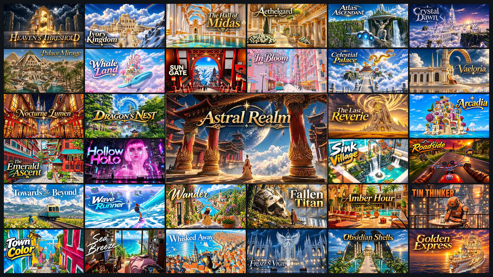

# Artistic 3D Environment Agent Skills (Three.js)

An agent skill pack for building artistic 3D environments in three.js that hold up as finished work: clean, sophisticated, physically coherent, and free of slop, from reading a reference image to the final graded frame. Each skill enforces a standard (default methods, minimums, banned stand-ins) and gives the procedure, diagnosis and tooling to meet it.

***This Agent Skill pack was distilled from these projects  of mine, watch on YouTube: [Three.js Quick Art](https://www.youtube.com/playlist?list=PLQPmfcq5rYL0)***

Start with **`env-build-protocol`**: it sets the phases and routes each part of the work to the skill that owns it.

| Skill | Owns | Tools and examples |
|---|---|---|
| [env-build-protocol](skills/env-build-protocol/SKILL.md) | Phases, gates, definition of done | — |
| [env-reference-reading](skills/env-reference-reading/SKILL.md) | Reading the reference, style deciding the method, open design | — |
| [env-camera-and-space](skills/env-camera-and-space/SKILL.md) | Lens, camera and layout solved from cues; a level, true-shaped world | `scripts/camera-solve.mjs` |
| [env-world-completion](skills/env-world-completion/SKILL.md) | The world beyond the frame, out to the horizon | — |
| [env-geometry-construction](skills/env-geometry-construction/SKILL.md) | Real construction, junctions, detail scale, supplied models | `scripts/meshkit/`, `examples/arcade-bay.mjs` |
| [env-ornament-and-relief](skills/env-ornament-and-relief/SKILL.md) | Composed ornament, carved or applied | `examples/scroll-panel.mjs` |
| [env-geometry-audit](skills/env-geometry-audit/SKILL.md) | Coplanar, support, clearance, shell audits, plus visual checks | `scripts/audit-lib.mjs`, `scripts/audit.mjs` |
| [env-vegetation](skills/env-vegetation/SKILL.md) | Botanical structure, rooting, LOD, wind | `examples/tree.mjs` |
| [env-terrain-rock-ground](skills/env-terrain-rock-ground/SKILL.md) | Rock, terrain, sand, snow, ground contact | — |
| [env-materials](skills/env-materials/SKILL.md) | Scanned PBR, projection, physical ranges, transparent media | `scripts/scan-stats.py` |
| [env-water](skills/env-water/SKILL.md) | FFT ocean, water shading, pools, breaking waves | `examples/fft-ocean/spectrum.mjs` |
| [env-sky-atmosphere-clouds](skills/env-sky-atmosphere-clouds/SKILL.md) | Built sky, sun, aerial perspective, volumetric clouds, media | `scripts/march-plan.mjs` |
| [env-lighting](skills/env-lighting/SKILL.md) | One sun, physical sun-to-sky ratio, designed light, emitters | `scripts/sun-sky.mjs` |
| [env-shadows-ao-gi](skills/env-shadows-ao-gi/SKILL.md) | Shadows, AO, occluded indirect light, reflections | — |
| [env-image-and-grade](skills/env-image-and-grade/SKILL.md) | Exposure, tone mapping, grade, bloom, lens traits | — |
| [env-temporal-stability](skills/env-temporal-stability/SKILL.md) | Correct in motion; animation plausibility | — |
| [env-look-iteration](skills/env-look-iteration/SKILL.md) | The measure → attribute → fix loop, and feedback handling | `scripts/measure.py` |

Every script runs headlessly and has a self-test: `node <script> --self-test` or `python3 <script> --self-test`. Meshkit uses `node scripts/meshkit/selftest.mjs`; the geometry audits use `node scripts/selftest.mjs`. The Node scripts have no dependencies. The Python scripts need Pillow and NumPy.

- **Install the pack whole:** some examples import toolkits from other skills (meshkit, the audit library).
- **three.js APIs** named in the skills were checked against the r187 source by identifier, and the key patterns (cascaded shadows, AO through `builtinAOContext`, `RenderPipeline` output order, `LightProbeGrid`) against shipped r187 code. The TSL snippets were not executed.
